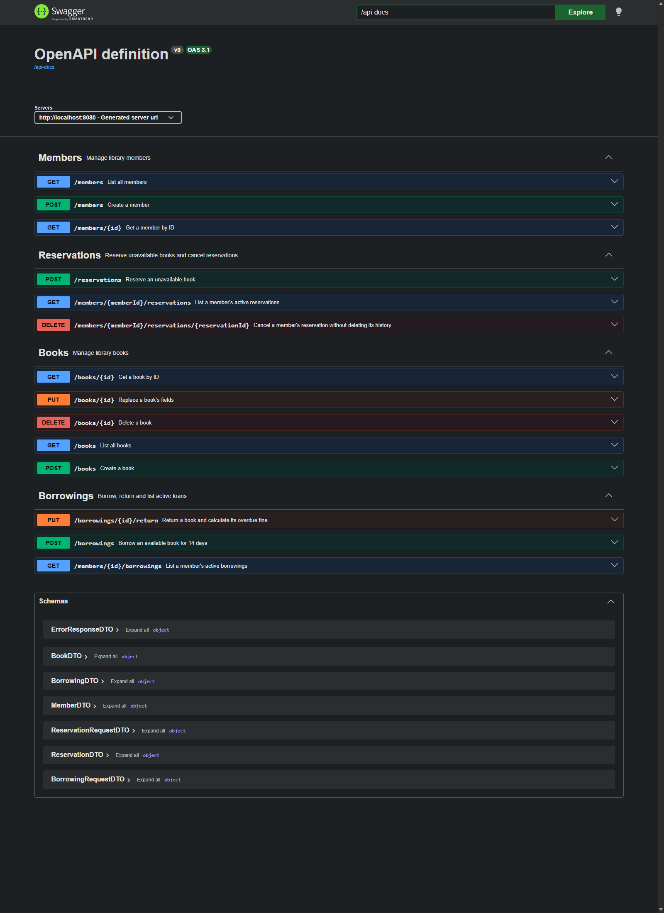

# Lab 4 — Design, Implementation, and Deployment

Source: SE_Lab_Assignment_2026_2027_Codex.docx, complete Lab4 StepsA–F,
deliverable questions and rubric. The existing Library API was reused.

**Status: technical steps verified; the student has approved the reviewed
48-file submission, exact commit message, lab-4 tag and push. Lab5 has not
started. Final Git references are verified after creating the commit.**

## 1. Design review findings

The actual StepA review, recorded before implementation, follows in full:

# Lab 4 — Step A design review (before changes)

Scope: all src/main/java entities, repositories, services, controllers and application entry point; all src/test/java classes; main resources. Starting commit: 2d5a1d40eba71ced30e0ffe5bbe6ff69605dd119 (lab-3).

| Concern / severity | Actual code evidence | Consequence and required action |
|---|---|---|
| Separation of concerns — CRITICAL | BookController.updateBook copies all entity fields and saves; create/delete methods also orchestrate persistence. MemberController.createMember assigns ID and saves directly. | Controllers mix HTTP and persistence/update policy. Move those operations into BookService and MemberService, retaining behavior. Existing BorrowingService and ReservationService already own domain workflows. |
| Layer coupling — CRITICAL | BookController constructor depends on BookRepository; MemberController on MemberRepository. | HTTP classes depend on persistence rather than a service abstraction, increasing coupling and reducing cohesion. Introduce the service boundary for these two resources. |
| API contract — CRITICAL | BookController exposes Book, MemberController exposes Member, BorrowingController exposes Borrowing, ReservationController exposes Reservation. Borrowing/Reservation responses nest actual Book/Member entities. | JPA state and API shape evolve together; adding a persistence field could unintentionally expose it. Introduce BookDTO, MemberDTO, BorrowingDTO and ReservationDTO plus explicit mappers. Preserve existing nested JSON fields and statuses so previous ACs remain valid. |
| Global errors — IMPORTANT | No ControllerAdvice exists. BorrowingController handles only IllegalStateException locally. ReservationController has separate conflict, lookup and request handlers. Book/Member use ResponseStatusException. | Current borrowing/reservation conflicts already return409; it would be inaccurate to claim they all return500. Unexpected exceptions and exceptions outside local handlers lack a uniform body/timestamp. Centralize handling; explicitly preserve ResponseStatusException404 so catch-all handling cannot convert missing records to500. |
| Validation evidence — IMPORTANT | ReservationRequest has @NotNull/@Valid; BorrowingRequest has no validation; no global field-error payload. Existing tests check several statuses but not the complete global mapping set. | Retain existing validation behavior and add global400 field errors. Add the assigned integration cases and tests for409/404/400/500 mappings. |
| OpenAPI — IMPORTANT | Springdoc dependency is present, but no controller has Tag/Operation/ApiResponse annotations; no DTO Schema annotations exist. application.properties has no /api-docs override. | Generated documentation lacks intentional summaries, response contracts and field examples. Add annotations to every current endpoint, including reservations, and verify running Swagger plus JSON. |
| Persistence/migration design — no new issue requiring a Lab4 change | Repositories extend JpaRepository; entities use generated IDs and unidirectional associations; existing domain services use transactions. | Preserve entities, repository behavior and borrowing/reservation rules. The concurrency concerns documented in Lab3 remain outside this design/deployment exercise. |
| Test organization — MINOR | Existing 68 cases combine Spring-backed service/controller and direct fine-unit tests; request fixtures repeat. | Tests already provide meaningful compatibility oracles. Keep every existing file/assertion unchanged; do not perform Lab5 fixture refactoring now. |

The two most serious issues are persistence/domain coupling in HTTP controllers and direct entity exposure. Both break separation/abstraction boundaries. Existing tests must remain the behavioral oracle while those boundaries change.

The latest user instruction explicitly authorizes this Lab4 DTO/controller/global-handler work. It supersedes Lab3's historical no-controller-change/no-Lab4 scope restrictions for this phase. The approved Lab3 document and tagged history remain unchanged.

The two most serious problems were HTTP/persistence coupling and direct entity
exposure. Previously BookController depended on BookRepository and implemented
field-copy/update persistence itself; MemberController likewise saved directly.
This reduced cohesion by combining transport, lookup, and persistence policy.
[BookService](../src/main/java/com/example/libraryapi/service/BookService.java)
and [MemberService](../src/main/java/com/example/libraryapi/service/MemberService.java)
now encapsulate those operations behind constructor-injected service APIs.
Controllers translate HTTP and map DTOs; they no longer import repositories.

Entity exposure coupled the external API to persistence structure, including
nested Book/Member references in Borrowing and Reservation. Explicit DTOs and
mappers provide an abstraction boundary while preserving every existing JSON
field, nested relationship, path, success code, and tested AC. ReservationDTO
was added as well as the three assigned DTOs because the rubric applies to
**all** controllers, including the feature added in Lab3.

The existing BorrowingService and ReservationService and all entities,
repositories, old tests, and POM were preserved. Twenty protected files were
checked by SHA256 and none changed. The Lab3 AGENTS.md remains a historical
approved specification; the user's explicit Lab4 instruction authorizes the
current DTO/controller changes without altering that tagged history.

Local borrowing/reservation handlers were removed and replaced with
[GlobalExceptionHandler](../src/main/java/com/example/libraryapi/exception/GlobalExceptionHandler.java),
annotated ControllerAdvice/ResponseBody. Its mappings are IllegalStateException
409; EntityNotFoundException and NoSuchElementException404; validation400 with
fieldErrors; malformed input400; unexpected Exception500. ResponseStatusException
keeps its actual status and reason, preserving all existing missing-record404s.
Every handled error includes error and an ISO UTC timestamp. Unexpected500
responses use a generic message instead of exposing internal exception text.

All four controllers have Tag annotations; all14 operations have Operation
summaries and appropriate ApiResponse entries. All fields of the seven DTOs
(four response resources, two ID requests, and ErrorResponseDTO) have Schema
examples. No new dependency or POM change was needed.

## 2. DTO decision

JPA entities describe persistence, not a versioned public interface. Returning
them directly means a newly added field or relationship can change JSON,
trigger ORM loading, expose an internal value, or create a cycle without an
intentional API decision. Input binding to entities can also expose persistence
fields that clients should not control.

A concrete example is
[BookDTO](../src/main/java/com/example/libraryapi/dto/BookDTO.java) and
[BookMapper](../src/main/java/com/example/libraryapi/mapper/BookMapper.java).
The DTO explicitly contains only id, isbn, title, author, genre, publishedYear,
and available. The mapper copies those fields explicitly. A future internal
Book persistence field would not automatically enter the API; changing the
contract would require a deliberate DTO/mapper change. That is a maintainability
and versioning improvement, not a claim that a sensitive Book field currently
exists. Creation still ignores supplied IDs, as the previous contract requires.

BorrowingDTO contains BookDTO and MemberDTO, not entities, so the existing
`book.id`, `member.id`, dates, and fine JSON remain compatible. ReservationDTO
similarly preserves exactly its five fields and nested relationships.
BorrowingRequestDTO/ReservationRequestDTO accept only IDs, with NotNull/Valid
using the installed validation dependency. Adding timestamp/fieldErrors to
error responses is the assigned intentional error-contract extension; it does
not remove existing error messages or statuses.

The new ApiDesignContractTest inspects controller signatures and nested DTO
field types for entity leakage, round-trips all four mappers, and exercises
Book CRUD/Member creation/read contracts. The unchanged Lab2/3 tests retain
their original assertions on borrowing/reservation behavior and nested JSON.

## 3. Pattern identification

1. **Repository:** BookRepository and ReservationRepository extend JpaRepository.
   Services use persistence operations and domain queries without writing
   database access in HTTP methods. For example,
   ReservationRepository.findByMemberIdAndActiveTrue expresses the member/active
   query behind a persistence abstraction. Repository centralizes persistence
   access and reduces coupling between workflows and database mechanics.
2. **Service Layer / application facade:** BookService and MemberService expose
   application operations to controllers and group persistence orchestration
   within transactions. BorrowingService already provides the borrow/return
   facade. A caller invokes one application operation rather than coordinating
   repositories and update rules in a controller. This improves separation of
   concerns and cohesion without changing the established borrowing policy.

The DTO/mapper boundary is an additional pattern: BookMapper, MemberMapper,
BorrowingMapper, and ReservationMapper adapt internal entities to explicit
transport records in both directions. GlobalExceptionHandler supplies a single
cross-cutting error policy instead of duplicated local handlers. These are
actual classes in the final implementation, not proposed future architecture.

## 4. Deployment reflection

The [Dockerfile](../Dockerfile) uses exactly the prescribed stages:
`maven:3.9-eclipse-temurin-17` builds with `mvn package -DskipTests`, then
`eclipse-temurin:17-jre-alpine` runs the copied executable JAR. It exposes8080
and starts Java with `-Xmx256m -Xms128m`. The final image contains the application
and JRE rather than the Maven toolchain and source tree. A multistage build
separates build tools from runtime requirements and makes the build reproducible
inside Docker instead of depending on the host JDK/Maven installation.

.dockerignore excludes Git, target, reports/docs, editor metadata, the assignment,
unrelated startup output, and local configuration/secret directories from the
build context. The runtime has only the JAR copied from the build stage. It uses
the assignment's runtime image and entrypoint; no production-hardening feature
or performance guarantee is claimed beyond that specification.

Docker initially failed because desktop-linux had no running Linux engine.
Outside-sandbox WSL inspection showed a docker-desktop WSL2 distribution; the
WSL1 optional-feature notice was not treated as proof that WSL2 was unavailable.
Approved `docker desktop start --detach` started the backend. Subsequent
`docker info` reported server29.8.0 and WSL listed docker-desktop Running/version2.
No WSL installation, operating-system reconfiguration, or reboot was required.

Actual deployment commands and results:

| Command / check | Actual result |
|---|---|
| docker build -t library-api:lab4 . | Exit0; Maven BUILD SUCCESS and image export completed |
| docker run -p 8080:8080 library-api:lab4 | Foreground container started; application/Tomcat listening on8080 |
| curl.exe http://localhost:8080/books (with evidence capture flags) | HTTP200 JSON containing the five original sample books |
| GET /swagger-ui.html with redirect following | HTTP302 to /swagger-ui/index.html, then HTTP200 HTML |
| Headless Edge opens running Swagger | Real screenshot/DOM saved; visually inspected14 operations in4 resource groups |
| GET /api-docs and /api-docs/swagger-config | JSON retrieved; UI configuration targets /api-docs; all14 documented operations inventoried |

Running container: **1e4523711063**, named **vibrant_lamarr**, using
library-api:lab4 with host8080 mapped to container8080. Image identity reported
by Docker: **sha256:fa83484d3e354321d0a36a37afb41c0820f26c86aec7c9fac775f0737b1972ce**.
Inspect confirms entrypoint `["java","-Xmx256m","-Xms128m","-jar","app.jar"]`.
The container was deliberately left running for review/screenshots. The Docker
build skipped test execution as prescribed; the separate host Maven suite is
the actual test evidence. The image was built from final production source;
the new host test classes were added afterward and do not change the runtime JAR.

Moving to PostgreSQL would require adding its JDBC driver in a separately
authorized change, supplying an external database/credentials/URL through
deployment configuration, replacing H2 create-drop with an appropriate durable
schema-management strategy, and revisiting sample-data initialization. The
current H2 database is in-memory and resets with the application lifecycle;
containerizing it does not make that data durable. PostgreSQL was not installed
or configured in this lab, so no PostgreSQL deployment result is claimed.

## Actual tests and grading verification

| Run | Tests | Failures | Errors | Skipped |
|---|---:|---:|---:|---:|
| Before changes | 68 | 0 | 0 | 0 |
| DTO/controller/global-handler migration, original suite | 68 | 0 | 0 | 0 |
| Complete final suite (mvn test) | **81** | **0** | **0** | **0** |

New tests: ApiDesignContractTest6 and GlobalExceptionHandlerTest7. The latter
includes the required real borrowing404/409 flows, validation400 with field
errors, malformed400, both assigned not-found exception types, and generic500
without internal-message leakage. Every prior test file/assertion is unchanged.
There were no test failures to conceal, weaken, or delete. Only Docker engine
startup and evidence-parser details required corrections, recorded in the log.

| Professor's criterion | Points | Verified evidence |
|---|---:|---|
| DTOs in all controllers; no entity responses | 3 | Four resource DTOs/mappers; controller signature and DTO-field guard; live OpenAPI schemas contain only DTO names |
| Global exception handler tests pass | 2 | Seven new SpringBootTest/MockMvc cases and all existing error/AC cases pass |
| Swagger UI shows all documented endpoints | 2 | Running rendered UI:14 operation blocks/4 groups; all summaries/statuses; DTO examples; real screenshot |
| Docker image builds and app starts | 3 | Build log, container/image inspection, startup logs and HTTP200 /books |

All four report questions are answered with actual project evidence. The
10-point rubric is traced without self-awarding a grade. StepF's exact commit
message is `lab4: DTOs, exception handler, OpenAPI docs, Dockerfile`; commit,
lab-4 tag and push were explicitly approved after the staged-file review. Final
Git identities are recorded in the actual tagged commit/remote references and
post-submission verification; a commit cannot contain its own resulting hash. Existing
lab-1/lab-3 and history are preserved; lab-2 was absent initially and is not
fabricated here. No Lab5 work is included.

Evidence lives under reports/evidence/lab4 and docs/lab4-evidence.md. Optional
manual captures can expand a Swagger operation to show its response table and
Schema examples; the actual captured overview is
.
